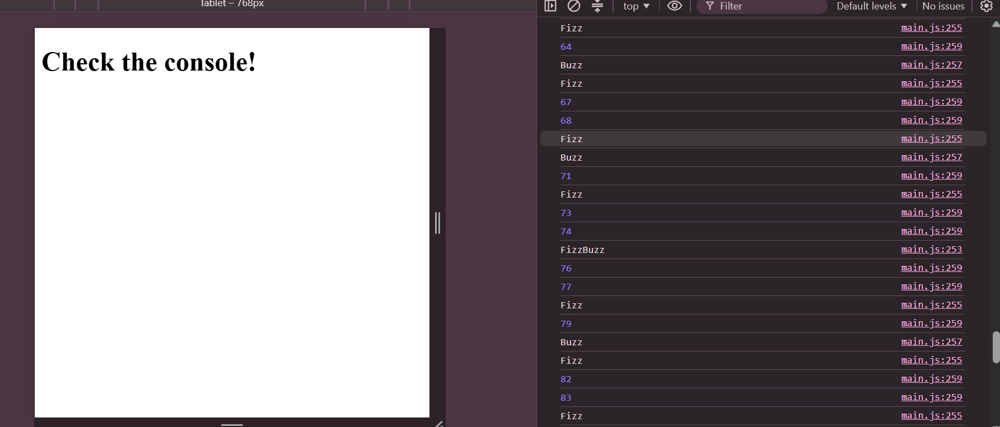

# Week 4: JavaScript Fundamentals

## Author
- **Name:** Caroline Wanjira
- **GitHub:** [@Caroline-wanjira](https://github.com/Caroline-wanjira)
- **Date:** November 7, 2026

## Project Description
A collection of JavaScript exercises covering the fundamentals: variables, data types, operators, functions, control flow, arrays, objects and JSON. It also includes two mini-projects (a console calculator and a student grade tracker) and a set of daily coding challenges. All output is shown in the browser console.

## Technologies Used
- HTML5
- JavaScript (ES6+)
- Git and GitHub
- VS Code with Live Server

## Features
- Variables, data types and operators practice
- Functions: declarations, expressions, arrow functions and default parameters
- Control flow with if/else, switch and loops (including FizzBuzz)
- Array methods: map, filter, find, reduce, some and every
- Objects, object iteration and JSON parse/stringify
- Calculator mini-project with division-by-zero handling
- Student Grade Tracker with averages, top student and report cards
- Daily challenges: reverse a string, largest number, remove duplicates, palindrome checker

## How to Run
1. Clone this repository
2. Open the folder in VS Code
3. Right-click `index.html` and choose **Open with Live Server**
4. Press F12 and open the **Console** tab to see the output

## Lessons Learned
- The difference between let and const, and how to use them
- How to write functions in different styles and when to use each
- How to work with objects and arrays of objects, and convert data to and from JSON

## Challenges Faced
- My first push to GitHub was rejected because I had deleted a file on GitHub's website, so my computer was missing that change. I fixed it by pulling first with git pull, then pushing again. Now I make all file changes in VS Code.
- Some lesson examples reused names that were already in my files, which causes errors. I fixed this by renaming the variables and functions.

## Screenshots 

